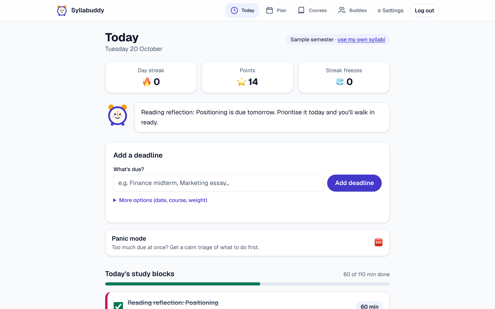
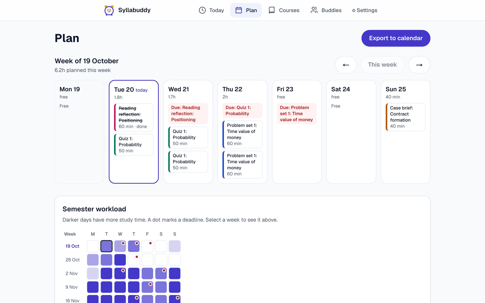
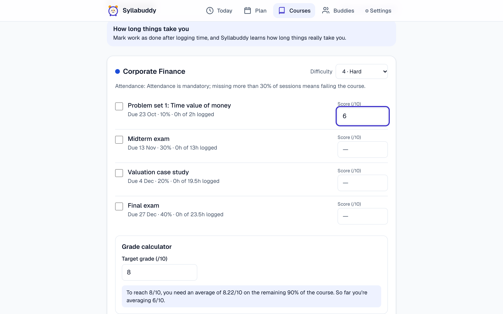
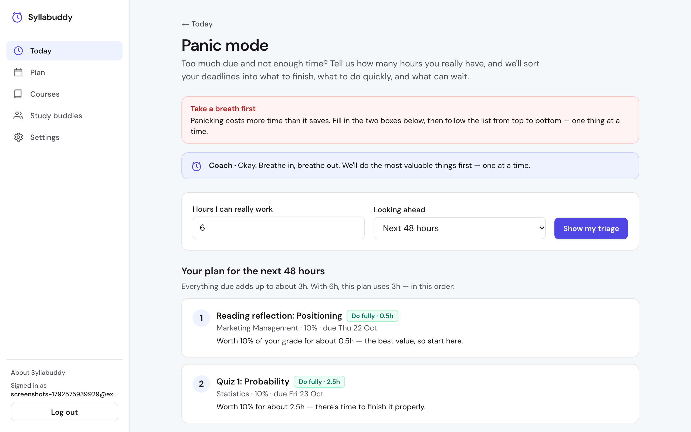
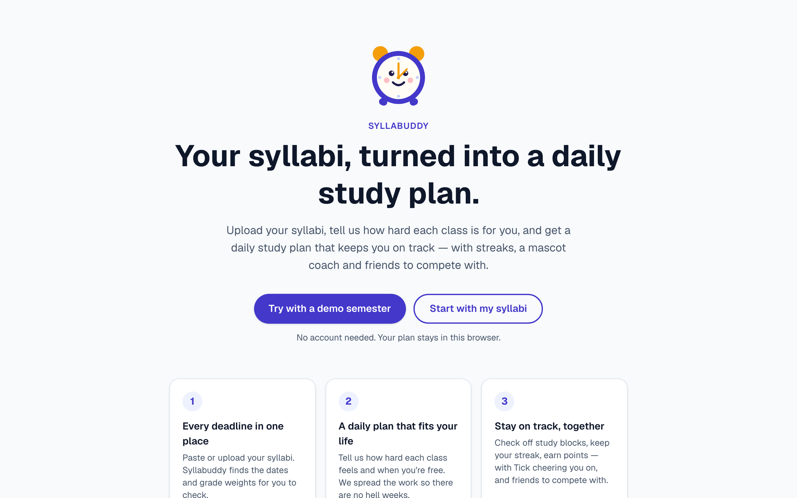
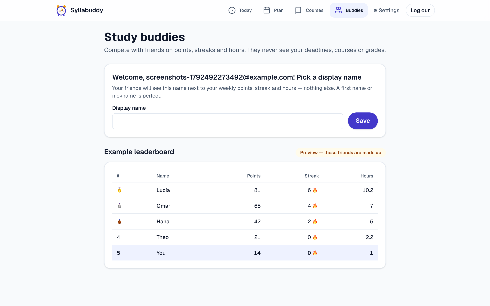
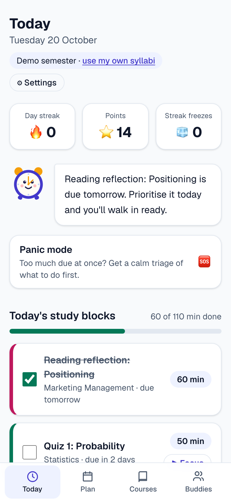
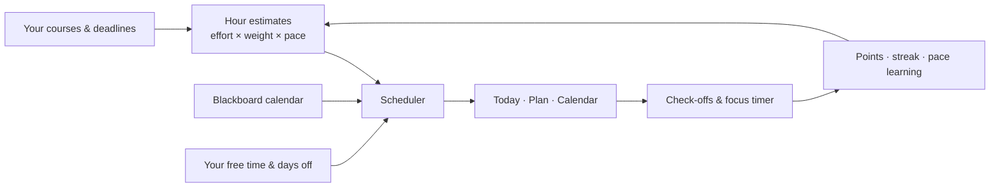

# Syllabuddy ⏰

**Add your deadlines, tell us how hard each class is for you, and get a daily study plan that keeps you on track — with streaks, a mascot coach and friends to compete with.**

🔗 **Live app: [syllabuddy-five.vercel.app](https://syllabuddy-five.vercel.app)** — sign up free with email and password, then add your first deadline (or click **“Load a sample semester”** to explore with four sample courses).



---

## The problem

University students juggle 5–7 syllabi, each a PDF with deadlines and grade weights buried somewhere inside. Nobody tells you *how much* to study *each day*, so it's easy to start too late and then burn out in the "hell weeks" where every midterm and project lands at once.

Syllabuddy turns those deadlines into a realistic daily plan: it spreads the work out, adapts when life gets in the way, and keeps you motivated without guilt-tripping you.

## Features

**Plan**
- ➕ **Add a deadline in seconds** — type what's due (e.g. "Finance midterm") and press *Add deadline*; the type is recognised from the title and the date, course and weight get sensible defaults you can change. It's saved to your account and planned immediately.
- 📚 **Your courses** — add each course with its deadlines and grade weights, how hard it is *for you* (1–5) and an optional target grade.
- 🏫 **Blackboard calendar** — connect your Blackboard calendar with its share link (or an `.ics` file). Each subject's classes are read with their session numbers ("Ses. 10"), shown on Plan and Today, and kept free of study blocks; Blackboard's deadlines can be added to a course with one click.
- 📝 **Exam prep plans** — paste what you need to study for an exam and it's organised into study days (setup, core topics, mock exam, repair day, light review), or choose *I'll organise it myself* and write your own plan per day. Export it as a PDF or to your calendar.
- 🌅 **Daily briefing** — the first screen: greeting, today's plan with times, what's coming up in the next 7 days and heads-ups (heavy week, missed blocks).
- 🗓️ **Daily schedule** — study blocks of 25–90 minutes, fitted around your free time per weekday and a daily cap.
- 🔁 **Automatic replanning** — missed blocks are moved forward from today, with a gentle note instead of a guilt trip.
- 📆 **Calendar export** — download an `.ics` file for Google Calendar, Apple Calendar or Outlook.
- 🌡️ **Plan view** — a week view plus a semester workload heatmap that shows hell weeks coming.

**Do**
- ✅ **Today** — today's blocks with checkboxes, deadlines in the next 72 hours, and a message from Tick.
- 🍅 **Focus timer** — 25/5 Pomodoro that logs minutes to the right deliverable and keeps working in background tabs.
- 🎓 **Grade calculator** — enter your scores so far and see the average you need on the rest (or a kind message if the target is no longer reachable).
- 🆘 **Panic mode** — too much due at once? A calm triage of what to finish, what to do a *minimum viable* version of, and what to let go.

**Stay motivated**
- 🔥 **Streaks, points and streak freezes**, with rest days that never break a streak.
- ⏰ **Tick, the mascot coach** — an original alarm-clock character with three tones: *gentle*, *coach* and *savage* (cheeky, never mean).
- 🌙 **Burnout guard** — after 3 days over your daily limit (or 7 days without a break), Tick suggests a night off, and **Protect tonight** moves today's work elsewhere.
- 🧑‍🤝‍🧑 **Study buddies** — add friends with an invite code and compete on a weekly leaderboard of points, streaks and hours. Until you join, you see an example leaderboard.

| Plan | Courses & grade calculator | Panic mode |
|---|---|---|
|  |  |  |

| Landing | Study buddies | Phone |
|---|---|---|
|  |  |  |

## How it works

All of the logic lives in small, unit-tested functions in [`lib/`](lib).

### Estimating hours — [`lib/estimate.ts`](lib/estimate.ts)
Each deliverable type has a base number of hours (exam 12, project 15, essay 8, quiz 2…), multiplied by:
- a **weight factor** — heavier work gets more time (`0.5 + weight/40`, between 0.5× and 2×),
- an **effort factor** — how hard the course is for you (0.6× to 1.6×),
- your **pace** — what Syllabuddy has learned about how long things really take you.

### The scheduler — [`lib/scheduler.ts`](lib/scheduler.ts)
1. Work is handled **earliest deadline first** (ties: higher weight first).
2. Each deliverable starts about `hours ÷ 2` days before its deadline and **ramps up** towards it — later days get a bit more, but you never cram it all into the last night.
3. Every day respects your free time for that weekday, your daily cap and your days off.
4. If there's still not enough time, it fills earlier free days, then allows at most 25% of the work on the deadline day itself — and anything that still doesn't fit becomes a clear warning (*"Finance final: 3h don't fit — consider Panic Mode or more availability"*).
5. **Replanning:** past blocks you didn't tick off become "missed", and their minutes go back into the pool from today. Finished work is never touched.

### Pace learning — [`lib/pace.ts`](lib/pace.ts)
When you mark something done, Syllabuddy compares the time you logged with the time it planned and updates a moving average (α = 0.3) for that **type of work** and that **course**. Future estimates use it, and the Courses page tells you in plain words: *"Your pace: essays take you 1.3× longer than planned."*

### Panic mode — [`lib/panic.ts`](lib/panic.ts)
Everything due in the next 24–72 hours is ranked by **grade points per hour** (`weight ÷ hours still needed`). Your available hours go to the best-value work first: finish it fully if it fits, do a *minimum viable* version (with concrete advice for that type of work) if at least 30% fits, otherwise consciously skip it.

### Also
- **Grade calculator** — [`lib/grades.ts`](lib/grades.ts): the average needed on the remaining components to reach your target.
- **Points & streaks** — [`lib/gamification.ts`](lib/gamification.ts): a block is worth `round(minutes/5) × (1 + weight/50)`; +10 per full focus session, +50 per finished deliverable; one streak freeze per 7-day streak (max 2).
- **Burnout guard** — [`lib/burnout.ts`](lib/burnout.ts).
- **Blackboard calendar** — [`lib/calendarIcs.ts`](lib/calendarIcs.ts) reads the `.ics` file (time zones, weekly repeats, cancelled classes); [`lib/blackboard.ts`](lib/blackboard.ts) groups classes by subject, numbers the sessions and turns evening classes into busy time.
- **Exam prep** — [`lib/examPlan.ts`](lib/examPlan.ts): pasted topics → setup, core days, mock exam and repair day (aimed at your weakest topics), light review.
- **Calendar export** — [`lib/ics.ts`](lib/ics.ts): RFC 5545 with CRLF line endings, UIDs, timestamps, escaping and line folding.



## Tech stack

| | |
|---|---|
| Framework | [Next.js 16](https://nextjs.org) (App Router) · React 19 · TypeScript |
| Styling | Tailwind CSS 4 — light & dark mode, WCAG 2.1 AA contrast |
| State & data | Zustand in the browser, saved to your account in Supabase (Postgres with Row Level Security) |
| Validation | Zod |
| Dates | date-fns |
| Accounts | Supabase Auth — email + password |
| Optional AI | Anthropic Claude via `@anthropic-ai/sdk` (Claude Haiku 5.5 by default) |
| Tests | Vitest (unit) · Playwright + axe-core (end-to-end, the grading bot's checks & accessibility) · PGlite (database rules) |
| Hosting | Vercel |

## Run it locally

You need [Node.js](https://nodejs.org) 20 or newer and a free [Supabase](https://supabase.com) project.

1. In Supabase: run [`supabase/schema.sql`](supabase/schema.sql) in the SQL editor, and turn **Authentication → Sign In / Providers → Email → Confirm email** off.
2. Copy [`.env.example`](.env.example) to `.env.local` and fill in your project's URL and publishable key.
3. Then:

```bash
git clone https://github.com/paubar-ui/syllabuddy.git
cd syllabuddy
npm install
npm run dev
```

Open http://localhost:3000 and sign up.

| Command | What it does |
|---|---|
| `npm run dev` | Start the development server |
| `npm run build` | Production build |
| `npm run lint` | Check the code with ESLint |
| `npm test` | 144 unit tests (Vitest) |
| `npm run test:sql` | Run the database schema in an in-memory Postgres and check the security rules (25 checks) |
| `npm run test:e2e` | Build the app and test it in a real browser at laptop and phone size, exactly like the grading bot: sign up, save a deadline, log out, wrong password refused, log in from a clean browser, second user can't see it, no access without login — plus WCAG 2.1 AA checks on every page (12 tests). Set `PLAYWRIGHT_BASE_URL` to test the live site instead. |

## Environment variables

Copy [`.env.example`](.env.example) to `.env.local` (git-ignored); on Vercel, add them under *Settings → Environment Variables*. The two Supabase values are required; the Anthropic ones are optional.

| Name | Used for |
|---|---|
| `ANTHROPIC_API_KEY` | Optional: richer explanations of an exam prep day. Without it, everything works offline. (Secret — server only.) |
| `ANTHROPIC_MODEL` | Which Claude model to use (default `claude-haiku-5-5`). |
| `NEXT_PUBLIC_SUPABASE_URL` | Your Supabase project URL (accounts and data). |
| `NEXT_PUBLIC_SUPABASE_PUBLISHABLE_KEY` | Your Supabase publishable (anon) key. Public by design — the database rules protect the data. |

On a deployed site, also add its address under Supabase *Authentication → URL Configuration*.

## Privacy

Syllabuddy is built to store as little as possible, and to keep it private:

- **Your account** is just an email and a password (handled by Supabase Auth; passwords are never stored in plain text).
- **Your plan** — deadlines, courses, study blocks, points and streak — is saved in one row in Supabase that **only you can read or change**. Row Level Security is on for every table, with rules based on `auth.uid()`: other users can't see your data, and nobody can read anything without logging in. These rules are tested automatically (`npm run test:sql`) and against the live site (`npm run test:e2e`).
- **PDFs are read in your browser.** Only if AI reading is switched on is the *text* (not the file) sent to the server and to Anthropic for extraction; Syllabuddy doesn't store it. The live app runs without AI.
- **Study buddies** is opt-in: friends only ever see the display name you choose and your weekly totals (points, streak, minutes) — never your deadlines, courses or grades. *Leave Study Buddies* removes that profile.
- **Only public values reach the browser** (the Supabase URL and publishable key); no secret keys are in the code or on GitHub.
- **You stay in control:** export or import your data as JSON and reset it any time in *Settings*.
- No analytics or tracking.

## Accessibility

Built to meet **WCAG 2.1 AA**: semantic HTML, labels on every control, full keyboard support (with a skip link and visible focus), colour contrast of at least 4.5:1 in light and dark mode, screen-reader announcements for points and timers, and respect for *reduced motion*. Every page is checked automatically with axe-core, and the layout works down to 375 px wide.

## How AI was used to build it

Syllabuddy was built for a university assignment with **[Claude Code](https://claude.com/claude-code)** (Anthropic's coding agent, running Claude Opus 5.5) in the Claude desktop app.

- **Spec first.** The product was described in [`CLAUDE.md`](CLAUDE.md) — goals, rules (no login for core features, demo mode, privacy, accessibility), data model, algorithms and pages — and built in phases using the prompts in [`PROMPTS.md`](PROMPTS.md).
- **Phase by phase.** Claude Code wrote the code and tests for each phase, ran lint, tests and the production build, and clicked through the app in a browser before each commit. I tried the app in the browser, made the product decisions, set up Supabase, GitHub and Vercel, and asked for changes when something felt off.
- **Decisions along the way.** With no AI key available, the offline syllabus reader became the main path instead of a fallback. When the assignment's grading contract arrived (email + password accounts, `/signup`, `/login`, `/app`, all user data in Supabase), the app was reworked to follow it: the plan moved from the browser into a private Supabase table, and "add a deadline" became the one-action main feature. Study buddies were designed so only weekly totals are shared. Personal email addresses were kept out of the public git history.
- **Tests caught real problems**, for example: "Problem *set 1*" being read as *September 1* (Spanish "set" = *setiembre*), a demo semester with more work than free time, faded text that failed contrast checks, and Next.js keeping hidden copies of earlier pages in the DOM — which duplicated test IDs and would have confused the grading bot.
- **Reading syllabi was tried and dropped.** Syllabi list the same assignment in several places (grading table, schedule, descriptions), so automatic import kept producing repeated or wrong deadlines. It was removed: you add deadlines yourself or from Blackboard, and for exams you paste exactly what you need to study.
- **AI inside the app is optional.** If `ANTHROPIC_API_KEY` is set, `/api/exam-day` can explain an exam prep day in more detail. Without a key the app never calls an AI service.

---

*Tick the mascot is an original design made for this project.*
